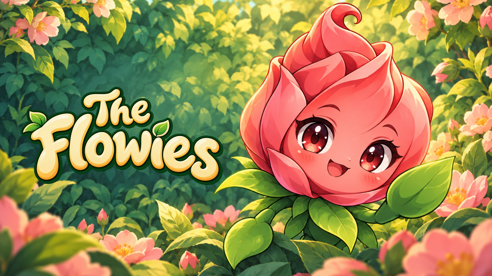

# The Flowies — Official Marketing Assets

Public press and promotional materials for **The Flowies**, a cozy garden collection game with match-3 puzzles.

## Download everything

[Download the complete media pack](flowies-marketing-assets-v1.zip)

## Cover images

| Format | Dimensions | Download |
|---|---|---|
| Landscape | 1920 × 1080 | [PNG](cover-landscape.png) |
| Portrait | 800 × 1200 | [PNG](cover-portrait.png) |
| Square | 800 × 800 | [PNG](cover-square.png) |

## Gameplay preview videos

Both MP4 files contain approximately 18 seconds of real-time gameplay and **no audio**, prepared for CrazyGames preview requirements.

- [Landscape video — 1920 × 1080](preview-landscape.mp4)
- [Portrait video — 1080 × 1620](preview-portrait.mp4)

## Logo and icon

- [Transparent game logo](the-flowies-logo.png)
- [Square icon — 512 × 512](the-flowies-icon.png)

## About the game

Plant mystery seeds, water buds, and meet friendly flower, fruit, and vegetable pets. Collect 65 forms across 13 species and five rarities, pair adult residents, complete garden tasks, and develop a greenhouse. Play Mosaic match-3 puzzles while your plants grow.

Desktop and mobile. Mouse and touch controls. English and Russian.

## Promotional use

These files are provided to CrazyGames and press/marketing partners for promotion and coverage of **The Flowies**. This is not a general stock-art collection or a grant to use the assets in other games. Artwork and branding were developed with generative AI assistance; the videos show the game itself. See [credits and provenance](CREDITS.md).

The game source code and playable game archive are not part of this media pack.
